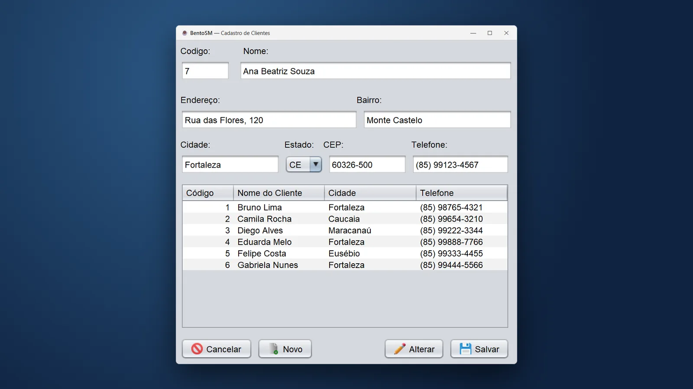
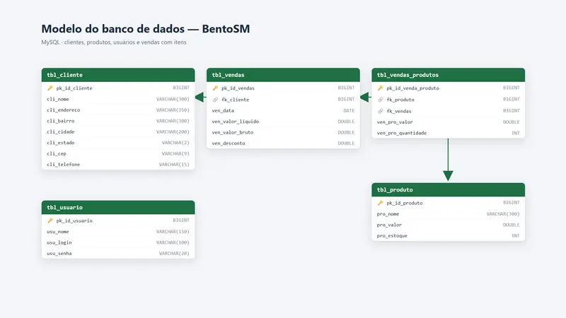
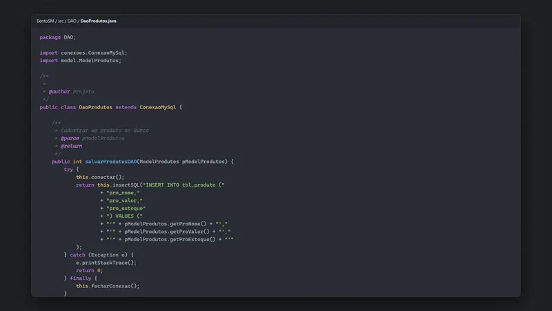

# BentoSM — Sistema de Supermercado em Java

Sistema desktop em Java Swing com MySQL: cadastro de clientes e camada de dados.

<p align="center">
  
</p>

---

## Sumário

- [Visão geral](#visão-geral)
- [Telas](#telas)
- [Stack e versões](#stack-e-versões)
- [Estrutura do projeto](#estrutura-do-projeto)
- [Primeiros passos](#primeiros-passos)
- [Autor](#autor)

---

## Visão geral

Início de um sistema desktop para supermercado, feito em 2018 em Java Swing no NetBeans com banco MySQL. Chegou a ter a tela de cadastro de clientes, a camada de produtos (model, DAO e conexão com o banco) e a modelagem completa do banco, com clientes, produtos, usuários, vendas e itens de venda. Foi o primeiro contato com orientação a objetos e com a separação em camadas.

Principais funcionalidades:

- Interface desktop com Java Swing
- Camadas model, DAO e conexão
- Banco MySQL com vendas e itens

Projeto do Ensino Médio Técnico em Informática (2018).

---

## Telas

A tela usa clientes fictícios.

<table>
  <tr>
    <td width="50%"><br><sub>Modelo do banco de dados</sub></td>
    <td width="50%"><br><sub>DAO de produtos</sub></td>
  </tr>
</table>

---

## Stack e versões

| Categoria | Tecnologia | Versão |
| --- | --- | --- |
| Linguagem | Java | 8+ |
| Interface | Java Swing (NetBeans GUI Builder) | — |
| Banco de dados | MySQL + JDBC (mysql-connector-java) | 5.1.18 |
| Relatórios | iText | 5.0.5 |
| Build | Apache Ant (NetBeans) | — |

---

## Estrutura do projeto

```
src/
  conexoes/   Conexão com o MySQL (ConexaoMySql)
  DAO/        Acesso a dados de produtos (DaoProdutos)
  model/      Modelo de produto (ModelProdutos)
  view/       Tela de cadastro de clientes (ViewCliente)
  imagens/    Ícones dos botões
biblioteca/   JARs usados (MySQL Connector, iText, UGComp)
bentosm.sql   Estrutura do banco: clientes, produtos, usuários, vendas e itens de venda
```

---

## Primeiros passos

### Pré-requisitos

- Java 8 ou mais recente (testado no 11)
- MySQL 5.7 ou mais recente
- NetBeans (o projeto usa o formato do NetBeans/Ant)

### Instalação

1. Crie o banco executando o script `bentosm.sql` no MySQL.
2. Ajuste servidor, usuário e senha em `src/conexoes/ConexaoMySql.java`.
3. Abra a pasta no **NetBeans** (as bibliotecas estão em `biblioteca/`) e execute a classe `view.ViewCliente`.

---

## Autor

**Marcos Paulo** · Desenvolvedor Full-Stack

- LinkedIn: [in/marcospsdev](https://www.linkedin.com/in/marcospsdev)
- GitHub: [@marcospsdev](https://github.com/marcospsdev)
